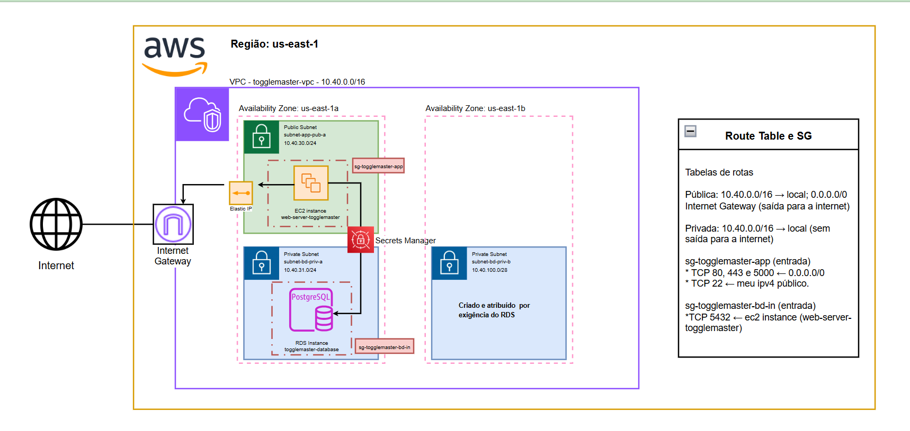
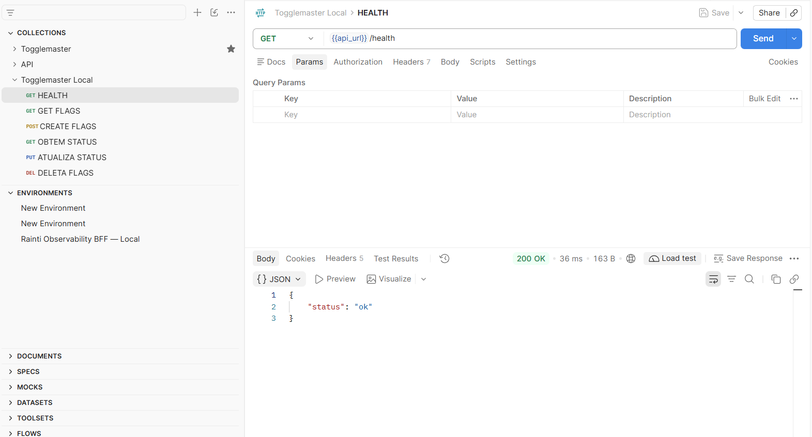
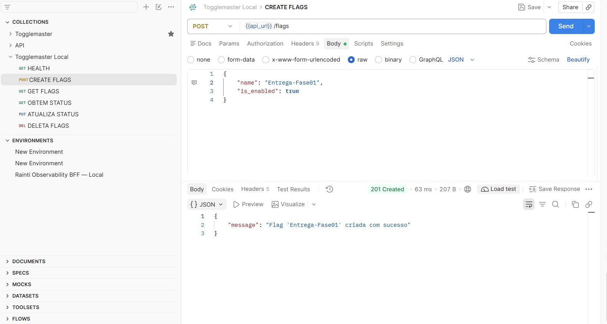
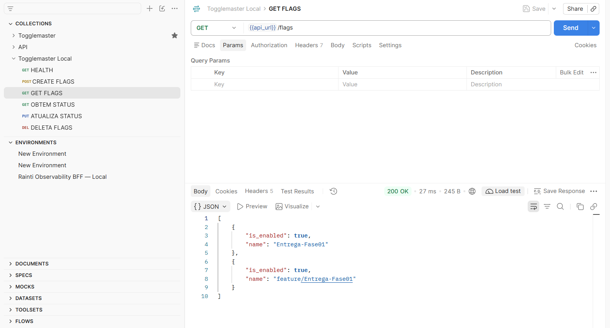
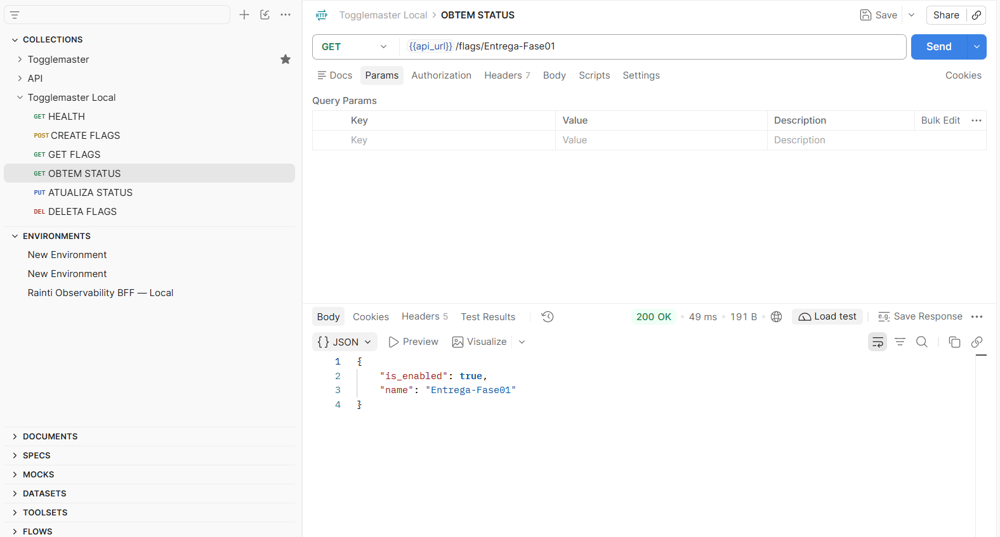
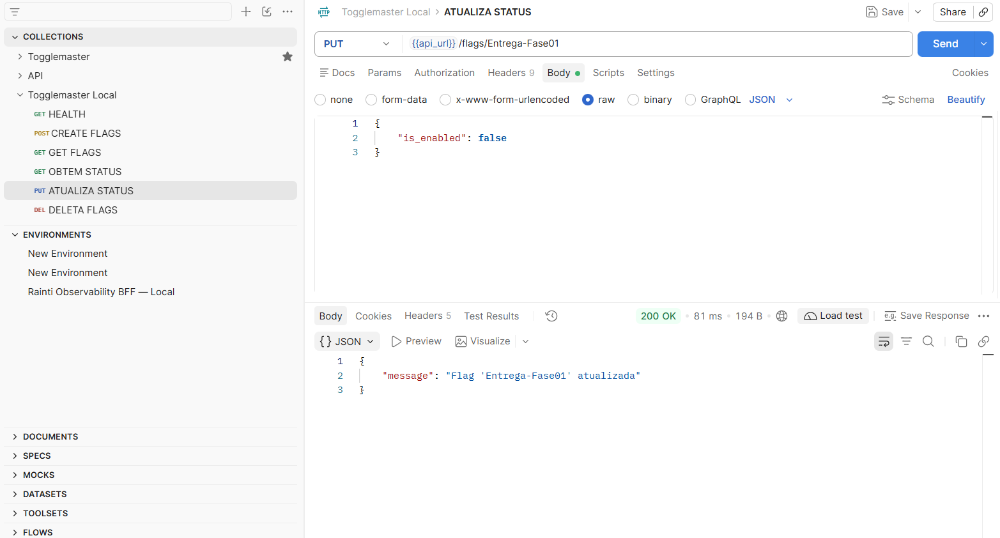
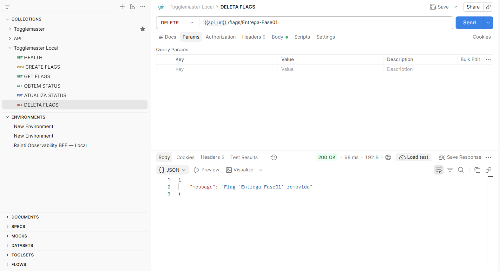

# FIAP — Pós-Tech DevOps (DCLT)
## Tech Challenge — Fase 1

**Grupo:** ToggleMaster  
**Data da entrega:** 03/11/2026

### Integrantes

| Integrante | RM |
|---|---:|
| Alyfer Ricardo Sousa de Oliveira | 378829 |
| Diogo da Silva Frota Soares | 378178 |
| Flávio Cardoso de Oliveira Soares | 377532 |
| João Guilherme Schneider da Silva | 377419 |
| Luciano Luan da Silva Alves | 378735 |

### Links do projeto

- **Repositório do grupo:** https://github.com/alyfer-oliveira/toggle-master-monolith.git 
- **Diagrama da arquitetura:** https://viewer.diagrams.net/?tags=%7B%7D&lightbox=1&target=blank&highlight=0000ff&edit=_blank&layers=1&nav=1&title=Diagrama%20sem%20nome.drawio&dark=auto#Uhttps%3A%2F%2Fdrive.google.com%2Fuc%3Fid%3D16jy_sp0eg1MBEux1nwCFF2pAjn8d5WwX%26export%3Ddownload
- **Vídeo de demonstração (até 15 minutos):** [inserir link]
- **Aplicação implantada (IP ou DNS):** http://54.81.198.105:5000
- **Estimativa da AWS:** https://calculator.aws/#/estimate?id=f120c50d60e2adcf69d6d7a434820ba0599e6d03

---

## 1. Resumo executivo

O Tech Challenge da Fase 1 teve como objetivo disponibilizar na AWS o **ToggleMaster**, um MVP monolítico para gerenciamento de *feature flags*. A API permite criar, consultar, atualizar e excluir flags, possibilitando controlar a liberação de funcionalidades e desativá-las rapidamente em caso de problemas, sem exigir um novo deploy da aplicação.

O grupo analisou e executou a aplicação localmente e preparou sua implantação em uma arquitetura AWS com uma instância **Amazon EC2** para executar a aplicação e um banco **Amazon RDS** para persistir os dados. A solução utiliza uma **VPC** com sub-redes públicas e privadas, regras de acesso definidas por *Security Groups* e o **AWS Secrets Manager** para disponibilizar credenciais. A entrega documenta a arquitetura, a aplicação dos 12 fatores, os testes realizados e a estimativa de custos. Os resultados específicos da validação e os links finais devem ser preenchidos nas seções correspondentes.

## 2. Análise da aplicação e da arquitetura monolítica

O ToggleMaster é considerado monolítico porque suas funcionalidades de API são desenvolvidas e executadas como uma única aplicação. A própria aplicação recebe as requisições, processa as operações relacionadas às *feature flags* e acessa o banco de dados. Seus componentes são implantados em conjunto, em vez de serem distribuídos como serviços independentes.

### Vantagens para um MVP

- Estrutura mais simples de compreender e desenvolver;
- Implantação e testes iniciais mais diretos;
- Menor custo operacional no começo do projeto;
- Comunicação direta entre os componentes da aplicação.

### Desvantagens e pontos de atenção

- Uma alteração pode exigir a implantação da aplicação inteira;
- Reinicializações durante o deploy podem causar indisponibilidade se não houver estratégia de atualização contínua;
- A aplicação é escalada como um todo, mesmo que apenas uma funcionalidade exija mais recursos;
- Com o crescimento do código, a manutenção pode se tornar mais difícil se os componentes não estiverem bem organizados.

## 3. Análise dos 12 fatores (12-Factor App)

A avaliação abaixo considera a solução implementada pelo grupo durante o desafio. “Atende parcialmente” indica que existe uma implementação inicial, mas há melhorias necessárias para maior segurança, repetibilidade ou confiabilidade em produção. As evidências devem corresponder à configuração efetivamente usada e podem ser incluídas como capturas de tela, trechos de configuração, comandos ou referências ao repositório.

| Nº | Fator | Avaliação | Análise, evidência e evolução recomendada |
|---:|---|---|---|
| 1 | **Base de código** | **Atende** | O projeto está versionado em GitHub: https://github.com/dougls/toggle-master-monolith. O grupo utilizou a branch `main`, cuja versão de referência corresponde à Pull Request nº 2, mergeada pelo usuário `dougls`, conforme descrito no modelo do projeto. Para comprovar a versão implantada, registrar também o commit utilizado e demonstrar que eventuais alterações feitas pelo grupo foram versionadas. |
| 2 | **Dependências** | **Atende** | As dependências Python são declaradas em `requirements.txt` e instaladas pelo `Dockerfile` com `pip install --no-cache-dir -r requirements.txt`. Para maior reprodutibilidade, manter versões fixadas e atualizar dependências de forma controlada. |
| 3 | **Configurações** | **Atende parcialmente** | No ambiente AWS, as credenciais são obtidas do AWS Secrets Manager e fornecidas ao ambiente de execução. O procedimento evita inserir segredos no código e reduz sua exposição em comandos do terminal. As variáveis temporárias do host utilizadas são removidas após o deploy. Para produção, preferir injetar segredos diretamente no processo ou serviço de execução, limitar permissões por IAM e evitar persistir credenciais em arquivos ou histórico de shell. |
| 4 | **Serviços de apoio** | **Atende** | O Amazon RDS é utilizado como banco de dados externo da aplicação, e o AWS Secrets Manager armazena/disponibiliza as credenciais necessárias. Esses recursos são configurados externamente à aplicação. A VPC e o Elastic IP são componentes de infraestrutura/rede, não serviços de apoio consumidos pela lógica da aplicação. |
| 5 | **Build, release e execução** | **Atende parcialmente** | A imagem da aplicação é construída a partir do código e das dependências definidos no projeto e executada em um container na EC2. O processo de obtenção das configurações e subida do container é feito por script. Para produção, separar claramente build, release e execução, identificar cada release por tag/commit e manter um procedimento de rollback. |
| 6 | **Processos** | **Atende parcialmente** | A API é executada como processo/container e usa o RDS para persistência dos dados. Isso evita que os dados principais dependam do armazenamento efêmero do processo da aplicação. Confirmar que sessões, arquivos enviados ou outros estados não essenciais não ficam exclusivamente na memória ou no disco local da EC2. |
| 7 | **Vínculo de porta** | **Atende parcialmente** | A aplicação disponibiliza a API por uma porta e o acesso externo é controlado pela configuração de rede da EC2. Registrar a porta efetivamente usada e, para produção, considerar TLS por meio de proxy ou balanceador e não expor portas internas desnecessárias. |
| 8 | **Concorrência** | **Atende parcialmente** | A execução em container permite iniciar processos da aplicação, mas a implantação utiliza uma única instância EC2. Para produção, avaliar múltiplas instâncias/containers, balanceamento de carga, limites de conexão do RDS e escalabilidade conforme a demanda. |
| 9 | **Descartabilidade** | **Atende parcialmente** | O container pode ser reiniciado sem que os dados persistidos no RDS sejam perdidos. A recuperação após falhas e o comportamento de encerramento devem ser validados. Para produção, configurar política de reinício, verificações de saúde, tratamento adequado de sinais de encerramento e tempo de inicialização previsível. |
| 10 | **Dev/prod semelhantes** | **Atende parcialmente** | A aplicação foi executada localmente e implantada na AWS, mas os ambientes diferem em infraestrutura e serviços gerenciados. Para reduzir diferenças, padronizar versões, automatizar a configuração e usar serviços equivalentes nos testes, sem compartilhar credenciais ou dados de produção. |
| 11 | **Logs** | **Atende parcialmente** | A aplicação pode emitir logs durante sua execução no container. O local de coleta e retenção dos logs da implantação deve ser registrado. Para produção, direcionar logs para uma saída centralizada, definir retenção e garantir que credenciais e dados sensíveis não sejam registrados. |
| 12 | **Processos administrativos** | **Atende Parcialmente** | O projeto não documenta, no material disponível, processos administrativos pontuais separados da execução da API, como migrações ou rotinas operacionais. Além disso, a aplicação inclui, no mesmo código da API, o comando manual init-db, registrado na CLI do Flask, para inicializar o banco de dados. Embora seja executado separadamente do processo que atende às requisições, esse comando não oferece, por si só, controle versionado da evolução do esquema. Para produção, documentar e automatizar essas tarefas para que sejam executadas sob demanda, com a mesma versão e configurações da aplicação, sem depender de alterações manuais não rastreáveis na EC2. Para o init-db, recomenda-se adotar migrações de banco de dados, executadas como processos administrativos pontuais e rastreáveis, para aplicar alterações de forma controlada e compatível com cada versão da aplicação. |

## 4. Pontos observados no código

- O método **DELETE** é solicitado no escopo do trabalho. Porém, a aplicação não possui este método configurado e habilitado. O grupo incluiu este método diretamente no código.
- Não há uma definição de fuso horário padrão no código, o que pode ocasionar divergências de horários do container. Para isto, foi adicionado uma lógica de instalação de componentes para definição e ajuste do timezone para "America/Sao_Paulo" vinda de dentro do container. 
- A API está acessível publicamente e não possui mecanismos de autenticação, o que permite que qualquer usuário alcance seus endpoints. Para um ambiente de produção, é necessário implementar controles de autenticação e autorização para restringir o acesso às operações.
- A API não valida nem restringe os caracteres usados no nome da feature flag. Por isso, é possível criar uma flag com caracteres especiais, como a barra (/). No entanto, esses caracteres podem interferir na forma como a API interpreta o caminho da requisição.

## 5. Arquitetura e tecnologias

### 5.1 Arquitetura proposta/implantada

A solução utiliza uma VPC com sub-redes públicas e privadas. A instância EC2 executa a aplicação e recebe o tráfego permitido pelas regras do seu Security Group. O Amazon RDS fica em sub-rede privada e aceita conexões na porta do banco somente do Security Group da EC2. O AWS Secrets Manager armazena as credenciais consumidas no processo de implantação/execução.

**Fluxo principal:**

1. O usuário envia uma requisição HTTP para o endereço público da aplicação;
2. A instância EC2 recebe a requisição conforme as regras do Security Group;
3. A API processa a operação solicitada sobre uma *feature flag*;
4. A aplicação conecta-se ao RDS por rede privada para consultar ou persistir os dados;
5. As credenciais são obtidas do AWS Secrets Manager conforme o procedimento configurado pelo grupo.

**Diagrama da arquitetura:** https://viewer.diagrams.net/?tags=%7B%7D&lightbox=1&target=blank&highlight=0000ff&edit=_blank&layers=1&nav=1&title=Diagrama%20sem%20nome.drawio&dark=auto#Uhttps%3A%2F%2Fdrive.google.com%2Fuc%3Fid%3D16jy_sp0eg1MBEux1nwCFF2pAjn8d5WwX%26export%3Ddownload 

**Imagem do diagrama:** 

### 5.2 Tecnologias e componentes

| Tecnologia/componente | Uso no projeto | Justificativa |
|---|---|---|
| ToggleMaster (Python) | API de gerenciamento de *feature flags* | Aplicação fornecida para o desafio e avaliada pelo grupo. |
| Docker | Empacotamento e execução da aplicação | Mantém aplicação e dependências em uma unidade implantável. |
| Amazon EC2 | Execução da aplicação na AWS | Hospeda o container da API. |
| Amazon RDS (PostgreSQL) | Persistência dos dados | Banco gerenciado acessado pela aplicação. |
| AWS Secrets Manager | Gestão das credenciais | Mantém as credenciais fora do código-fonte. |
| Amazon VPC, sub-redes e Security Groups | Segmentação e controle de tráfego | Define a comunicação entre EC2, RDS e usuários. |
| Elastic IP | Endereço IPv4 público estável para a EC2 | Facilita o acesso por endereço fixo. |

## 6. Desenvolvimento e implementação

### 6.1 Etapas executadas

1. Acesso ao repositório e análise da estrutura da aplicação;
2. Execução local para compreender o funcionamento da API;
3. Análise da arquitetura monolítica e dos 12 fatores;
4. Desenho da arquitetura AWS com VPC, sub-redes, EC2, RDS e Security Groups;
5. Provisionamento manual dos recursos pelo console da AWS;
6. Conexão à EC2 por SSH e instalação/configuração dos componentes necessários;
7. Configuração das credenciais e da conexão da aplicação ao RDS;
8. Inicialização da aplicação e validação de acesso público e persistência.

### 6.2 Decisões adotadas

- O grupo decidiu manter a arquitetura monolítica do ToggleMaster, adequada ao escopo de um MVP e ao objetivo de disponibilizar a aplicação na AWS. A API foi executada em um container Docker hospedado em uma instância EC2, enquanto os dados são armazenados em um Amazon RDS PostgreSQL. Essa separação mantém a aplicação e o banco em componentes distintos, sem exigir a divisão da API em serviços independentes.
- A infraestrutura foi organizada em uma VPC com sub-redes públicas e privadas. A EC2 foi posicionada na sub-rede pública para permitir o acesso à API, e o RDS foi colocado em uma sub-rede privada, com acesso de rede controlado por Security Groups. Também foi utilizado um Elastic IP para manter um endereço público estável para a instância.
- Para gerenciar as credenciais, o grupo adotou o AWS Secrets Manager e criou um script para obtê-las durante a implantação, evitando armazená-las diretamente no código-fonte. A aplicação foi construída e executada com Docker, e as dependências foram instaladas conforme definidas no projeto.
- Durante a análise, o grupo também identificou pontos que precisam evoluir antes de uma utilização em produção: a API está publicamente acessível sem autenticação, o comando init-db inicializa o banco manualmente, e a implantação ainda depende de procedimentos que podem ser mais automatizados e rastreáveis. Como próximos ajustes, recomenda-se implementar autenticação e autorização, adotar migrações versionadas para mudanças no esquema do banco e fortalecer a automação de deploy e a observabilidade.
- Como o método DELETE era solicitado no escopo do desafio, mas não estava implementado na aplicação original, o grupo decidiu adicioná-lo à API para permitir a exclusão de feature flags e completar as operações CRUD previstas.
- Também foi definido o fuso horário do container como `America/Sao_Paulo`, evitando divergências entre os horários registrados pela aplicação e o horário local utilizado pelo grupo.

### 6.3 Como executar e avaliar

**Pré-requisitos:** Git, Docker e acesso ao ambiente AWS; Python/pip caso a execução local não seja feita via container.

**Execução local:**

```bash
# Obter o projeto
 git clone https://github.com/dougls/toggle-master-monolith.git
 cd toggle-master-monolith

# Criar arquivo .env a partir do .env.example contendo as variáveis de ambiente do projeto

# Subir Projeto com o comando abaixo:
 docker compose -f docker-compose-local.yaml up -d --build
```

**Execução na AWS:** [Passo a Passo de Execução] (doc/md/Passo_a_Passo_ToggleMaster_AWS.md)

**Endpoint público e porta:** http://54.81.198.105:5000
**Exemplos de requisições para CRUD:** 

### Exemplos de requisições para CRUD

A tabela abaixo apresenta os endpoints utilizados para testar as operações de criação, consulta, atualização e exclusão de *feature flags*. Substitua os caminhos e exemplos pelos endpoints reais da aplicação.

| Operação | Método HTTP | Endpoint | Resultado esperado |
|---|---|---|---|
| Obter status health | `GET` | `/health` | Obtém status da aplicação |
| Criar uma *feature flag* | `POST` | `/feature-flags` | Cria uma nova *feature flag*. |
| Consultar *feature flags* | `GET` | `/feature-flags` | Retorna as *feature flags* cadastradas. |
| Atualizar uma *feature flag* | `PUT` | `/feature-flags/{name}` | Atualiza a *feature flag* identificada pelo ID. |
| Excluir uma *feature flag* | `DELETE` | `/feature-flags/{name}` | Exclui a *feature flag* identificada pelo ID. |

`GET - /health`


`POST - /feature-flags`


`GET - /feature-flags`


`GET - /feature-flags/{name}`


`PUT - /feature-flags/{name}`


`DELETE - /feature-flags/{name}`


## 7. Gestão do trabalho em equipe

O grupo é composto por cinco integrantes. A equipe utilizou o repositório GitHub para compartilhar o código do projeto.

- **Repositório e controle de versão:** GitHub — https://github.com/alyfer-oliveira/toggle-master-monolith.git (Branch: release/TCL01)

### 7.1 Desafios e aprendizados

- **Desafio encontrado:** [descrever problema real]
- **Decisão ou solução adotada:** [descrever o que o grupo fez]
- **Aprendizado:** [descrever o resultado ou conhecimento adquirido]

## 8. Conclusão e próximos passos

A Fase 1 propõe validar o ToggleMaster como um MVP de gerenciamento de *feature flags* e exercitar a implantação de uma aplicação monolítica na AWS. A arquitetura definida separa a execução da aplicação, hospedada na EC2, do armazenamento de dados, fornecido pelo RDS, e utiliza recursos da AWS para segmentação de rede e gestão de credenciais.

A conclusão final deve refletir os resultados efetivamente demonstrados pelo grupo, indicando se a aplicação ficou acessível publicamente, se as operações CRUD foram validadas e se a conexão com o RDS foi comprovada. Como próximos passos, recomenda-se automatizar a infraestrutura e o deploy, aprimorar monitoramento e logs, implementar alta disponibilidade e escalabilidade quando necessário, fortalecer controles de acesso e completar os ajustes dos 12 fatores identificados como parciais ou pendentes.

## Referências

- **FIAP.** Tech Challenge — Fase 1, Pós-Tech DevOps (DCLT). Material fornecido para a atividade.
- **GitHub.** `toggle-master-monolith`. Disponível em: https://github.com/dougls/toggle-master-monolith. Acesso em: 14/10/2026.

## Apêndices e evidências

- diagrama da arquitetura AWS;
- capturas das sub-redes e dos Security Groups;
- evidência da instância EC2 e do RDS;
- evidência do acesso SSH (sem chave privada ou dados sensíveis);
- evidência das operações da API e da persistência no banco;
- trecho do script de deploy e configuração do Secrets Manager, sem valores secretos;
- print da estimativa de custos;
- link do vídeo de demonstração (até 15 minutos).
